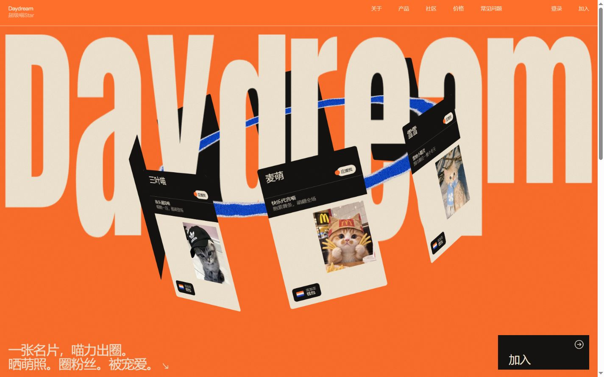

# Daydream · 超级喵Star

一个为明星猫咪打造的数字名片展示网站。采用暖橘 `#FF6F2C` 与荷青 `#A1E6DD`，结合巨型动态字标、纸张颗粒和 3D 旋转名片。

## 体验

- 八张等尺寸猫咪名片，每 46 秒旋转一圈，前后穿过品牌字标。
- 点击名片后从原位平滑放大到屏幕中央，查看时暂停旋转。
- 点击关闭按钮、空白遮罩或按 `Esc` 收起名片，卡环继续旋转。
- 支持手机、平板、电脑与横竖屏布局，适配系统的“减少动态效果”偏好。
- 第二屏展示“冷萌帅咪”照片、介绍及猫咪名片主题文案。

八位喵明星按顺序为：**灰太喵、三叶喵、麦萌、雪雪、蘑菇喵、黑天使、老钱喵、喵啡**。

## 使用

直接用浏览器打开 `index.html` 即可。CSS、JavaScript、猫咪照片与字体均包含在这个文件中，无框架、无构建步骤。

蓝色纸环和撕纸圆形装饰使用远程图片，显示这些装饰需要网络连接。

登录、注册与钱包内容目前为界面展示，未连接后端服务。

## 文件

- `index.html`：完整单文件网页，可直接编辑其中的文案、样式和交互。
- `screenshot.jpg`：网页预览图。
- `licenses/`：嵌入字体的原始许可证。

字体使用 Anton、Six Caps、Instrument Sans，来源为 [Google Fonts](https://github.com/google/fonts)。
